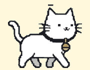

<div align="center">



# Пушик

**Кот Пуш живёт у тебя на рабочем столе и помогает работать.**

Гуляет по экрану и по краям окон, спит, умывается, гоняется за хвостом, напоминает о встречах из Google Календаря и отвечает на вопросы через Claude или локальную Ollama.

*Push the cat lives on your desktop: walks on top of your windows, reminds you about meetings and chats via Claude or a local Ollama model. Russian and English UI.*


Автор проекта: **[@prettyw1ld](https://github.com/prettyw1ld)**

</div>

> [!NOTE]
> **Пуш — персонаж компании билайн.** Это неофициальный фанатский проект: я очень люблю билайн и этого котика, поэтому решил сделать с ним своего десктопного агента. Проект не связан с билайном и не одобрен им; все права на персонажа принадлежат билайну.

---

## Помощник для тех, кто только знакомится с компьютером

Сделано для хакатона «Вайбкодинг ФКН», тема «Без инструкции». Кот ведёт человека, который только знакомится с компьютером, от «ничего не понимаю» до первого получившегося действия. **Кот ничего не нажимает сам**: он показывает лапкой, а нажимает человек, так он учится.

<p align="center"></p>

1. **Знакомство и тренажёр мыши.** При первом запуске кот просит нажать на него, потом два раза быстро, потом перетащить. Это тренировка клика, двойного клика и перетаскивания на живом персонаже.
2. **«Чем тебе помочь?»** Клик по коту открывает крупные кнопки-задачи: «Позвонить по видео», «Посмотреть фото с флешки», «Найти в интернете», «Сделать буквы крупнее». Свои кнопки можно вписать в настройках. Ещё можно написать задачу словами или сказать в микрофон.
3. **Работает без ИИ, без ключей и без интернета.** Для каждой кнопки-задачи есть готовый сценарий из шагов (`src/renderer/scenarios.js`). Нужные кнопки на экране кот находит через системную «доступность»: UI Automation в Windows и Accessibility на Mac (`src/locate.js`). Так он знает, где «Пуск», значок WhatsApp, флешка в Проводнике, адресная строка браузера, ползунок размера текста. Флешку замечает сам, как только её вставили.
4. **Показывает лапкой.** Кот подходит или подпрыгивает к кнопке, машет на неё лапкой, обводит жёлтой рамкой и читает подсказку вслух. Одна подсказка = одно действие, до 12 слов, без терминов. Если не получается, есть «Покажи ещё» и «Открой за меня».
5. **Сам видит, что шаг сделан.** Открылось нужное окно, появилась следующая кнопка, пропала кнопка звонка: кот радуется и переходит к следующему шагу. Если человек долго ничего не делает, кот сам предлагает показать ещё раз.
6. **«😵 Я запутался».** Кот говорит простыми словами, какое окно сейчас открыто, и показывает лапкой на его крестик. С ИИ он ещё и объясняет, что на экране.
7. **«⭐ Что я уже умею».** Каждый пройденный путь записывается в список навыков.
8. **ИИ как бонус.** Если команда положила ключ (см. ниже), кот ещё понимает любые задачи словами: делает снимок экрана (только в память) и спрашивает модель с зрением (Claude или Ollama), куда показать. Тогда же он предупреждает об опасном: форма с данными карты, скачивание `.exe`, баннер «ваш ПК заражён».

**Голос без интернета.** Кнопка 🎤 распознаёт речь прямо в приложении через [Vosk](https://alphacephei.com/vosk/) (WebAssembly) с маленькой русской моделью, ключ не нужен. Кот слушает слова команд («хочу позвонить по видео», «фото с флешки», «я запутался»), поэтому почти не ошибается. Модель (около 40 МБ) скачивается сама при `npm install` и попадает в установщик. Если микрофона нет, кнопка прячется, а кнопки-задачи и ввод текстом работают как обычно. Для свободной речи можно включить Whisper по ключу (по умолчанию бесплатный [Groq](https://console.groq.com)). Подсказки читаются вслух системным синтезом речи.

**Ключи ставит команда, а не пользователь.** Скопируй `team.example.json` в `team.json` и впиши ключи. При `npm run dist` файл попадёт в установщик, и человеку ничего вводить не придётся. Ключ из установщика можно вытащить, так что для демо это нормально, а для настоящего продукта нужен свой сервер-посредник. Без `team.json` всё основное работает по готовым сценариям.

**Анимации.** Три окраса (рыжий, белый, чёрный), 66 анимаций из листов 64×64 в `design/cats/`: ходьба и бег в четыре стороны, умывание сидя и лёжа, мяуканье, чесание, виляние хвостом в разных позах, удары лапкой (так кот показывает на кнопку), зевок, шесть поз сна, еда, шипение, прыжки, стойка на задних лапах.

---

## Знакомьтесь, Пуш

Белый кот с чёрным ошейником и жёлтым колокольчиком, талисман билайна. Все кадры анимации вырезаны из пиксельных листов-референсов в `design/ref/`.

<p align="center"></p>

## Что умеет

**Живёт своей жизнью**
- гуляет на четырёх лапах, а на дальние расстояния бегает;
- запрыгивает на верхние края окон и гуляет по ним, едет вместе с окном и спрыгивает, если окно закрыть;
- садится к тебе лицом, смотрит в экран со спины, сидит в профиль;
- умывается, играет с клубком, валяется, зевает, потягивается;
- гоняется за хвостом, охотится, смотрит на птичку;
- пьёт кофе, ест из миски, роняет чашку со стола;
- спит калачиком или на спине.

**Реагирует на тебя**

| Действие | Что делает Пуш |
|---|---|
| клик | открывает меню |
| двойной клик | мурчит и смущается 💛 |
| 5 быстрых кликов | злится 😾 |
| перетащить мышкой | висит за шкирку, потом падает на лапы |
| долго не гладили | садится и выпрашивает внимание 🥺 |

Пуш тихонько мяукает, мурчит, когда гладишь, шипит, когда злится, и звенит колокольчиком перед встречей. Звук выключается в настройках.

**Помогает**
- 💬 **Чат** (`Ctrl/Cmd+Shift+P`) через Claude или бесплатно через локальную [Ollama](https://ollama.com). Можно просто попросить: «напомни через 20 минут позвонить маме» или «что у меня сегодня в календаре?».
- 📅 **Google Календарь**: Пуш показывает встречи на сегодня и завтра и за 10 минут до начала зовёт тебя.
- ⏰ **Напоминания** с системным уведомлением. Они сохраняются между запусками.
- 🎯 **Фокус на 25 минут** с таймером над котом.
- ☕ **Перерывы**: раз в N минут Пуш зовёт размяться.
- 🗂 **Трей**: позвать Пуша, открыть чат, напоминания, настройки, спрятать.

Клики по пустым местам экрана проходят сквозь окно кота, он не мешает работать.

## Запуск

Нужен [Node.js](https://nodejs.org) 18 или новее.

```bash
git clone https://github.com/prettyw1ld/Desktop-Helper.git
cd Desktop-Helper
npm install
npm start
```

### Настройки ⚙

| Что | Как |
|---|---|
| **Claude** | ключ с [console.anthropic.com](https://console.anthropic.com). Хранится зашифрованным средствами системы |
| **Ollama** | поставь [Ollama](https://ollama.com), скачай модель `ollama pull qwen3` и выбери «Ollama» в настройках. Работает без интернета и бесплатно |
| **Google Календарь** | Google Календарь → Настройки → твой календарь → «Секретный адрес в формате iCal». Вставь адрес в настройки, он тоже хранится зашифрованным. Календарь только читается |
| **Размер кота** | ползунок от маленького до огромного |
| **Окна** | галочка «Пуш гуляет по верхним краям окон» (Windows и macOS) |
| **Язык** | русский или английский, по умолчанию как в системе |
| **Окрас кота** | белый, рыжий или чёрный |
| **Кому звоню** | необязательно: имя контакта, как в WhatsApp. Тогда кот покажет лапкой прямо на него, иначе попросит выбрать нужное имя |
| **Кнопки-задачи** | по одной на строку, например «📞 Позвонить Маше в WhatsApp». Пусто = стандартные |
| **Голос** | бесплатный ключ с [console.groq.com](https://console.groq.com). Можно указать OpenAI (`https://api.openai.com/v1`, `whisper-1`) или свой whisper-сервер |
| **Читать вслух** | галочка «Читать подсказки вслух» |
| **macOS** | чтобы кот показывал лапкой, разрешите Пушику «Универсальный доступ», а для ИИ ещё и «Запись экрана» |

### Сборка установщика

```bash
npm run dist:win   # на Windows
npm run dist:mac   # на macOS
```

## Как устроено

| Файл | Что внутри |
|---|---|
| `src/main.js` | прозрачное окно поверх всех, трей, настройки, напоминания, горячая клавиша |
| `src/llm.js` | чат через Claude Messages API или Ollama и инструменты (напоминания, фокус, календарь) |
| `src/calendar.js` | Google Календарь по iCal-адресу |
| `src/windows.js` | где сейчас окна других программ (PowerShell на Windows, JXA на macOS) |
| `src/renderer/i18n.js` | все тексты на русском и английском |
| `src/renderer/sound.js` | звуки, синтезированные Web Audio |
| `src/preload.js` | безопасный мост между окном и главным процессом |
| `src/guide.js` | снимок экрана, запрос к модели с зрением, слежка за изменениями экрана |
| `src/stt.js` | голос → текст через Whisper-совместимый сервис |
| `src/locate.js` | поиск кнопок без ИИ: UI Automation (Windows) и Accessibility (macOS) |
| `src/renderer/scenarios.js` | готовые сценарии кнопок-задач |
| `src/renderer/coach.js` | ведёт по сценарию: показывает, ждёт, проверяет; «Я запутался» без ИИ |
| `src/renderer/voice.js` | голос без интернета (Vosk) |
| `tools/fetch-vosk-model.js` | скачивает русскую модель Vosk (`npm run vosk`) |
| `src/renderer/cats.js` | разметка спрайт-листов: какая строка какая анимация |
| `src/renderer/app.js` | поведение кота, помощник, тренажёр мыши и панели |
| `assets/cats/` | спрайт-листы котов (исходники `.aseprite`, палитра и подписанные листы в `design/cats/`) |
| `assets/sprites/ref/` | кадры Пуша из прошлых версий |
| `tools/extract_ref*.py` | вырезают кадры из листов-референсов в `design/ref/` |

Чтобы обновить кота, замени референсы в `design/ref/` и запусти скрипты из `tools/` (нужен Pillow). Можно и просто подложить свои PNG в `assets/sprites/ref/` с теми же именами.

Интерфейс открывается и в обычном браузере (`src/renderer/index.html`): там включается тестовый режим без Claude, с ненастоящим помощником и ненастоящим «рабочим столом» для сценария звонка. `?ai` включает ИИ-режим. `?onboarded` пропускает тренажёр мыши, `?color=white` меняет окрас.

## Автор

Проект сделал **[@prettyw1ld](https://github.com/prettyw1ld)** из любви к билайну и его котику Пушу.
Код написан вместе с [Claude](https://claude.ai).

Код распространяется по лицензии [MIT](LICENSE). Персонаж Пуш и его образ принадлежат билайну и под лицензию MIT не подпадают.
