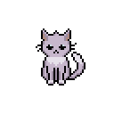

<div align="center">

# Пушик



**Кот, который учит пользоваться компьютером прямо на твоём экране. Без инструкций.**


-1b1d22?style=for-the-badge&labelColor=ffd43b)

Хакатон «Вайбкодинг ФКН» · тема 1 «Без инструкции»

</div>

---

## Проблема

Бабушке нужно позвонить внуку по видео, сделать текст покрупнее или найти скачанный файл. Инструкция ей не поможет: в ней слова «панель задач», «Проводник», «контекстное меню», а на экране всё выглядит не так, как на картинке. Позвонить родным, чтобы объяснили, неудобно, и через неделю всё забудется.

Людей, которые впервые сели за компьютер в 60+, очень много. Им нужна не инструкция, а кто-то рядом, кто покажет пальцем.

## Решение

**Пушик это кот, который живёт поверх всех окон и показывает лапкой, куда нажать.** Он не говорит терминами, не открывает справку и **ничего не нажимает сам**: нажимает человек, поэтому он и учится.

- Кот подходит к нужной кнопке на **настоящем экране**, машет на неё лапкой, обводит рамкой и говорит подсказку вслух.
- Одна подсказка это одно действие, не больше 12 простых слов.
- Кот **сам видит**, что шаг сделан (открылось окно, появилась кнопка, стало громче), радуется и ведёт дальше. Нажимать «Далее» не нужно.
- Если человек потерялся, кот объяснит, что на экране и что сейчас произошло.

## Что умеет

### Уроки, которые проверяют себя сами
Все обучалки в одном месте, от простого к сложному, с прогрессом:

| Урок | Что человек научится делать |
|---|---|
| Мышка | нажать, нажать два раза, перетащить (тренировка при первом запуске) |
| Обзор компьютера | рабочий стол, «Пуск», панель задач, часы и звук, крестик у окна |
| Звук громче | кот сам замечает, что громкость изменилась |
| Буквы крупнее | найти настройку размера текста |
| Поиск в интернете | открыть браузер и найти что-то |
| Звонок по видео | позвонить через WhatsApp |
| Фото с флешки | кот сам замечает вставленную флешку |
| Файлы и папки | Проводник на Windows, Finder на Mac |
| Где мои загрузки | найти скачанный файл |
| Открыть свой документ | кот помогает найти и открыть нужный файл |

**Уроки работают без интернета и без ИИ.** Нужные кнопки кот находит через системную «доступность»: UI Automation на Windows и Accessibility на Mac. Поэтому он знает, где «Пуск», адресная строка браузера или флешка в Проводнике, не делая снимков экрана.

### «Объясни, что это»
Человек обводит непонятное место на экране, и кот объясняет, что это и зачем. Он же предупреждает об опасном: форма с данными карты, скачивание `.exe`, баннер «ваш ПК заражён». В ИИ отправляется **только выделенный кусочек**, а не весь экран. Если кот не уверен, он так и говорит.

### Задача своими словами
Большая кнопка «Сказать задачу»: «хочу позвонить внуку», «сделай звук громче». Голос распознаётся **прямо на компьютере** через Vosk, без интернета. Если подключён ИИ, кот понимает любую фразу (Whisper) и сам ищет на экране, куда показать.

### Учиться не страшно
- **«Проще»**: кот перескажет подсказку ещё проще.
- **«Попробовать самому»**: кот прячет подсказку и только проверяет.
- **«Что сейчас произошло?»**: кот объясняет, что изменилось на экране.
- **Домик навыков**: за каждое умение в комнате кота появляется вещь. За первый успех человек получает открытку, её можно сохранить и отправить внукам.

### Кот, а не робот
Три окраса, 66 пиксельных анимаций: гуляет по краям окон, спит, умывается, играет с клубком, мурчит, если погладить. Всегда поверх окон, но клики по пустому месту проходят насквозь и не мешают работать.

## Почему это подходит под «Без инструкции»

| Обычно | С Пушиком |
|---|---|
| Читаешь инструкцию с терминами | Кот показывает лапкой на твоём экране |
| Картинка в инструкции не совпадает с экраном | Кот находит кнопку там, где она у тебя |
| Сам решаешь, получилось или нет | Кот сам видит, что шаг сделан |
| Без интернета ничего | Уроки и голос работают офлайн |
| За тебя нажимают, ты не учишься | Кот никогда не нажимает сам |

## Как мы используем ИИ

ИИ здесь **бонус, а не основа**: всё главное работает без него.

- **Зрение** (Groq, `qwen3.8-27b`): понять незнакомый экран, объяснить выделенный кусок, найти кнопку для свободной задачи.
- **Чат** (Groq, `gpt-oss-120b`): пересказать проще, ответить на вопрос.
- **Голос** (Groq Whisper): свободная речь вместо слов-команд.
- Модели подбираются автоматически из доступных у провайдера. Если лимит запросов кончился, кот говорит «Секундочку, я думаю…» и ждёт, а не показывает ошибку.
- Все ошибки переведены на человеческий язык: никаких «fetch failed».

Снимок экрана делается только в память и никуда не сохраняется.

## Запуск

Нужен [Node.js](https://nodejs.org) 18 или новее.

```bash
git clone https://github.com/prettyw1ld/Desktop-Helper.git
cd Desktop-Helper
npm install      # заодно скачает офлайн-модель голоса (~40 МБ)
npm start
```

### Подключить ИИ (необязательно)
Ключи ставит команда, а не пользователь. Скопируйте `team.example.json` в `team.json` и впишите бесплатный ключ с [console.groq.com](https://console.groq.com):

```json
{ "provider": "groq", "apiKey": "gsk_…", "voice": "whisper" }
```

`team.json` в `.gitignore`, в репозиторий он не попадает. Подробнее в [GROQ-SETUP.md](GROQ-SETUP.md).

### Установщик со значком на рабочем столе
```bash
npm run dist:win   # Windows: dist/Пушик Setup ….exe
npm run dist:mac   # macOS
```
Установщик кладёт ярлык на рабочий стол и в «Пуск». Если рядом лежит `team.json`, он попадает внутрь, поэтому такой установщик нельзя выкладывать в открытый доступ.

На macOS разрешите Пушику «Универсальный доступ», а для ИИ ещё и «Запись экрана».

## Как устроено

```
Человек ──► Кот (окно поверх всех) ──► Урок (scenarios.js)
                     │                         │
                     │                ищет кнопку: locate.js
                     │                (UI Automation / Accessibility)
                     │                         │
                     ▼                         ▼
             «Что произошло?»,        показывает лапкой ──► ждёт ──► проверяет сам
           «Объясни, что это»                                         (coach.js)
                     │
                     ▼
        ИИ по желанию: guide.js + llm.js (Groq)
```

| Файл | Что внутри |
|---|---|
| `src/main.js` | окно поверх всех, трей, настройки, автозапуск |
| `src/locate.js`, `src/native/` | поиск кнопок без ИИ на Windows и Mac |
| `src/renderer/scenarios.js` | уроки: шаги, подсказки, проверки |
| `src/renderer/coach.js` | ведёт по уроку: показывает, ждёт, сам проверяет |
| `src/guide.js`, `src/screen-region.js` | снимок экрана и выделенная область для ИИ |
| `src/llm.js`, `src/http.js` | запросы к ИИ, подбор моделей, повторы и ожидание лимита |
| `src/stt.js`, `src/renderer/voice.js` | голос: Whisper по ключу, Vosk без интернета |
| `src/files.js` | помощь с файлами и папками |
| `src/renderer/inspect.js` | «Объясни, что это» |
| `src/renderer/playful.js`, `home.js` | открытка, клубок, домик навыков |
| `src/renderer/app.js`, `cats.js` | поведение и анимации кота, панели |

Тесты: `node --test tools/test-file-help.js`.

Интерфейс открывается и в обычном браузере (`src/renderer/index.html`) с ненастоящим рабочим столом для отладки: `?onboarded` пропускает тренировку мышки, `?color=white` меняет окрас.

## Стек
Electron 33, чистый JavaScript без фреймворков, PowerShell и UI Automation (Windows), Swift и Accessibility API (macOS), Vosk (WebAssembly), Groq API, Web Audio.

## Команда
- Дамир Ходжиев
- Георгий Масленников
- Егор Мацегора
- Грачев Александр

Авторы на GitHub: [@prettyw1ld](https://github.com/prettyw1ld), [@Jikeman](https://github.com/Jikeman), [@Geonori](https://github.com/Geonori), [@7grach](https://github.com/7grach).

Код распространяется по лицензии [MIT](LICENSE). Персонаж Пуш и его образ принадлежат билайну и под лицензию MIT не подпадают: это фанатский проект.
