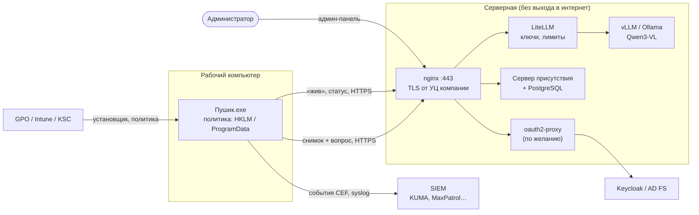

# Пушик для организаций: развёртывание и настройка

Руководство администратора: как поставить Пушика в компании, подключить свою модель ИИ, настроить политику, админ-панель и журнал. Обычный Пушик для дома остаётся прежним: корпоративный режим включается только политикой на компьютере.

| | |
|---|---|
| Для кого | ИТ-отдел, отдел ИБ, администратор рабочих мест |
| Статус | пилот (ветка `enterprise`, версия 0.9.x) |
| Платформа | Windows 10/11 x64; macOS — без групповой политики |
| План работ | [PLAN.md](PLAN.md) · что проверить руками: [CHECKLIST.md](../CHECKLIST.md) |

Содержание: [что это](#1-что-это-и-чего-пушик-не-делает) · [схема](#2-как-устроено) · [требования](#3-требования) · [пилот за час](#4-пилот-за-час) · [установка на парк](#5-установка-на-парк) · [политика](#6-политика) · [ролевые пакеты](#7-ролевые-пакеты) · [сервер модели](#8-сервер-модели) · [админ-панель](#9-сервер-присутствия-и-админ-панель) · [журнал и SIEM](#10-журнал-и-siem) · [сеть](#11-сеть-и-порты) · [подпись и EDR](#12-подпись-доверие-и-edr) · [обновления](#13-обновления-и-откат) · [внедрение](#14-внедрение-по-кольцам) · [152-ФЗ и ФСТЭК](#15-152-фз-и-фстэк) · [неполадки](#16-если-что-то-не-работает) · [удаление](#17-удаление-и-данные) · [безопасность](#18-поддержка-и-уязвимости)

---

## 1. Что это и чего Пушик не делает

Пушик — кот поверх окон, который показывает лапкой, куда нажать, и объясняет непонятное на экране. В организации он отвечает на вопросы по рабочим программам и правилам ИБ (ролевые пакеты), помогает сообщить об инциденте и предупреждает о подозрительном (удалённый доступ, туннели наружу).

Что гарантирует корпоративный режим:

- **Снимки экрана не покидают компанию.** ИИ — только на адресе из политики. Облачные модели (Groq, Claude, DeepSeek, Qwen) выключены, запасного облачного варианта нет.
- **У ИИ нет рук.** Пушик ничего не нажимает и не запускает за человека ([ADR-0002](adr/0002-no-agent-actions.md)).
- **Испорченная политика выключает ИИ**, а не открывает дорогу наружу. Политику, которую мог подложить обычный пользователь, Пушик не читает.
- **Сервер может только ужесточить** политику компьютера, но не ослабить её ([ADR-0001](adr/0001-signed-remote-config.md)).
- **В журнале нет содержимого:** ни снимков, ни текста вопросов и ответов — только события.
- При вводе пароля, в менеджерах паролей, на окне UAC и в программах из чёрного списка Пушик на экран не смотрит.

Чего Пушик не делает: не следит за продуктивностью (админ-панель показывает только «кот запущен / компьютер заблокирован / выключен» — сообщите это сотрудникам), не является средством защиты информации и не заменяет антивирус или DLP.

## 2. Как устроено



| Что уходит с компьютера | Куда | Когда | Содержимое |
|---|---|---|---|
| Снимок экрана (или только окна) и вопрос | сервер модели из `ai.url` | человек попросил показать или объяснить | картинка, названия кнопок окна, текст вопроса с вычищенными номерами карт, ИНН, СНИЛС, паспортов и ключей |
| «Жив» и смены состояния | сервер присутствия из `presence.url` | раз в 45 с, при блокировке, сне, выходе | имя ПК, пользователь, версия, состояние, минуты без мыши |
| События журнала | SIEM из `siem` | при событии | тип события и метаданные, без содержимого |
| Ничего | интернет | никогда | облачные модели и облачное распознавание речи выключены; голос распознаётся на самом ПК (Vosk) |

## 3. Требования

| Что | Минимум | Заметки |
|---|---|---|
| Рабочие места | Windows 10 22H2 / Windows 11, x64, 4 ГБ ОЗУ | Пушик на Electron 45; PowerShell 5.1 (есть в Windows) |
| Сервер модели, пилот | GPU 24 ГБ (L4, A10, RTX 3090/4090) | Qwen3-VL-4B-Instruct (BF16) или 8B-Instruct (FP8/AWQ) |
| Сервер модели, отдел и больше | GPU 48 ГБ (L40S, RTX 6000 Ada) | 8B BF16 или 30B-A3B AWQ/FP8; вторая GPU — для отказоустойчивости |
| Демонстрация без GPU | 8 ядер, 16 ГБ ОЗУ | Ollama `qwen3-vl:4b-instruct`, ответ за несколько секунд |
| Сервер присутствия | 1 vCPU, 1 ГБ ОЗУ, Docker, PostgreSQL 16 | `server/deploy` |
| Сеть и доверие | DNS-имена серверов, сертификаты от УЦ компании | корневой сертификат УЦ уже в «Доверенных корневых центрах» на ПК |
| Каталог (по желанию) | Keycloak / AD FS (OIDC), группы AD для администраторов | для входа в админ-панель |

Ёмкость (оценка, проверить нагрузочным тестом `vllm bench serve` на своих снимках): одна GPU 24 ГБ — порядка 1–3 запросов в секунду, это 1 000–3 000 сотрудников, которые спрашивают кота время от времени. Снимок Full HD — около 2 000 токенов.

## 4. Пилот за час

Быстрее всего — пробный стенд на одном компьютере: он сам включает корпоративный режим, ставит локальную модель в Ollama, поднимает админ-панель и приёмник журнала.

```powershell
git clone https://github.com/prettyw1ld/desktop-helper -b enterprise; cd desktop-helper
npm install; npx electron-builder --win --dir
.\docs\enterprise\try\try.ps1          # Windows спросит права администратора один раз — чтобы записать политику
.\docs\enterprise\try\try.ps1 -Off     # вернуть обычного Пушика
```

Подробности — [try/README.md](try/README.md). Для настоящего пилота на 10–20 человек:

1. Поднимите сервер модели (раздел 8) и проверьте его с любого ПК пилота:
   `curl https://llm.corp.local/v1/models` — в ответе есть ваша модель.
2. Поднимите сервер присутствия (раздел 9).
3. Соберите установщик и разошлите его вместе с политикой (разделы 5 и 6). Минимальная политика:

   ```json
   {
     "org": "Пилот ИБ",
     "ai": { "kind": "openai", "url": "https://llm.corp.local/v1", "model": "pushik-vl" },
     "privacy": { "screenshots": "window", "denyApps": ["1cv8", "iBank2"] },
     "presence": { "url": "https://pushik.corp.local", "secret": "секрет-регистрации-от-16-знаков", "group": "Отдел ИБ" },
     "siem": { "host": "siem.corp.local", "port": 6514, "proto": "tls" }
   }
   ```
4. Проверка: в настройках Пушика нет выбора модели; «Объясни, что это» отвечает; в админ-панели кот «бодрствует»; в SIEM пришли `start` и `look`.

## 5. Установка на парк

Корпоративный установщик ставит Пушика на всю машину в `%ProgramFiles%` и рядом собирает MSI-обёртку для GPO и KSC:

```
npm run dist:win:corp      # → dist-corp/Pushik-Setup-<версия>.exe и .msi (собирать на Windows)
```

Конфигурация — [`electron-builder.corp.yml`](../../electron-builder.corp.yml). `appId` и `upgradeCode` в ней не меняются никогда: по ним системы управления узнают установленного Пушика и обновление.

| Система | Что ставить | Команда | Как понять, что стоит |
|---|---|---|---|
| Intune (Win32, контекст System) | `.intunewin` из `Pushik-Setup-x.y.z.exe` | `Pushik-Setup-x.y.z.exe /S` | файл `%ProgramFiles%\Пушик\Пушик.exe`, версия ≥ x.y.z |
| Intune / MECM, MSI | `Pushik-Setup-x.y.z.msi` | `msiexec /i Pushik-Setup-x.y.z.msi /qn` | код продукта MSI |
| GPO «Установка программ» | только `.msi`, назначение компьютеру | — | — |
| Kaspersky Security Center | инсталляционный пакет из `.msi` (или «пользовательский» из `.exe` с `/S`) | тихий режим | результат в KSC |
| Ansible | `ansible.windows.win_package` | `arguments: /S` | `path` к exe |

Коды выхода NSIS: 0 — успех, 1 — отменено, 2 — ошибка; MSI — стандартные (0, 3010, 1641, 1618). Тихое удаление: `"%ProgramFiles%\Пушик\Uninstall Пушик.exe" /S` или `msiexec /x {код} /qn`.

> Ключи и коды проверьте на своей сборке до раскатки: сборка установщика на всю машину пока проверена только на этапе конфигурации ([CHECKLIST.md](../CHECKLIST.md), раздел «Сборка»).

Обычная сборка (`npm run dist:win`) ставится в профиль пользователя без прав администратора — она для дома, в компании используйте корпоративную.

## 6. Политика

Политика превращает обычного Пушика в корпоративного. Два источника:

1. **Групповая политика** `HKLM\Software\Policies\Pushik` — главнее. Значения: `AiUrl`, `AiModel`, `Screenshots`, `PresenceUrl`… ([полный список](policy.md#групповая-политика-windows)). Доставка: GPO «Реестр», Intune (импорт ADMX или OMA-URI), KSC.
2. **Файл** `%ProgramData%\Pushik\policy.json` — то же самое JSON-ом; поля из реестра перекрывают поля файла.

Политика читается при запуске Пушика. Справочник всех полей — [policy.md](policy.md).

**Кто может менять политику.** Пушик читает `policy.json` и пакеты, только если их владелец «СИСТЕМА» или группа «Администраторы» и писать в них могут только они. Файлы, положенные через GPO, Intune, MECM или KSC, и файлы, скопированные из PowerShell «от имени администратора», так и выглядят. Файл, который скопировал администратор без повышения прав, принадлежит его учётной записи — такой Пушик не примет (в журнале событие `policy` с причиной `policy file not trusted`). Закрыть папку один раз:

```powershell
$d = "$env:ProgramData\Pushik"; New-Item -ItemType Directory -Force $d | Out-Null
icacls $d /inheritance:r /grant:r '*S-1-5-18:(OI)(CI)F' '*S-1-5-32-544:(OI)(CI)F' '*S-1-5-32-545:(OI)(CI)RX'
icacls $d /setowner '*S-1-5-32-544' /T
```

Главные поля:

| Поле | Зачем |
|---|---|
| `ai` | адрес и модель вашего сервера; `null` — ИИ выключен, работают только уроки |
| `features` | что разрешено: чат, показ по шагам, «Объясни, что это» |
| `privacy.screenshots` | `screen` / `window` (только окно, с которым работают) / `off` (без картинки, только названия кнопок от Windows) |
| `privacy.denyApps`, `privacy.masks` | где не смотреть на экран; свои маски (табельные номера и т.п.) |
| `answers.allowHosts` | на какие адреса ИИ может давать ссылки |
| `presence` | сервер присутствия, подразделение, ключ подписи настроек |
| `siem` | куда слать журнал |
| `tunnels` | предупреждать или закрывать туннели наружу (cloudflared, ngrok, `ssh -R`) |

## 7. Ролевые пакеты

Пакет — JSON с уроками, правилами для ИИ и пояснениями к служебным окнам (антивирус, DLP) для конкретной роли: «Безопасность для сотрудника», «Новый сотрудник», «Бухгалтерия». Лежат в `%ProgramData%\Pushik\packs\`, читаются только в корпоративном режиме, требования к владельцу те же, что у политики. Формат и примеры — [packs.md](packs.md), готовый пакет — [packs/security.json](packs/security.json): проверка подозрительного письма, пересылка в SOC, чат ИБ, передача файла через сервис секретов, BitLocker, VPN, сообщение об инциденте. Перед раскаткой замените в нём адреса и телефоны ИБ (раздел `vars`).

## 8. Сервер модели

Рекомендуется **Qwen3-VL Instruct** (не Thinking): 4B — лучший по цене поиск кнопок на экране, 8B — запас по качеству объяснений, 30B-A3B — максимум. Пушик знает, что Qwen3-VL даёт координаты в долях 0..1000, и просит их так же.

- **vLLM ≥ 0.11** (ниже — уязвимость CVE-2025-6242), слушает только `127.0.0.1`, перед ним nginx и LiteLLM. Структурированный вывод — `response_format` (`guided_json` удалён в 0.12).
- **Ollama** — для пилота и одного отдела: `OLLAMA_CONTEXT_LENGTH=8192`, `OLLAMA_NUM_PARALLEL=4`, `OLLAMA_KEEP_ALIVE=-1`, `OLLAMA_NO_CLOUD=1`; версия ≥ 0.12.7.
- **LiteLLM** — ключи на отдел, лимиты, учёт. Обязательно `turn_off_message_logging: true` и `LITELLM_OFFLINE_MODE=true`; у шлюза нет выхода в интернет (картинки по ссылкам он скачивает даже в офлайн-режиме — Пушик шлёт только base64).
- Веса скачиваются заранее, сверяются по контрольным суммам и переносятся в закрытый контур; vLLM — с `HF_HUB_OFFLINE=1`.
- nginx перед шлюзом: `client_max_body_size 20m`, `proxy_read_timeout 120s` (снимок в base64 — до 4 МБ, Пушик сам ограничивает запрос 12 МБ и 60 с).

Команды запуска, конфиг LiteLLM и nginx — [server.md](server.md#1-сервер-модели-vllm--qwen3-vl-8b-litellm).

## 9. Сервер присутствия и админ-панель

Админ-панель показывает котов по подразделениям: бодрствует, дремлет, спит (экран заблокирован, компьютер выключен, Пушик закрыт), потерялся. Карточка устройства — история за 7 дней, версия, пакеты, применённые настройки. Режим «табло» — для экрана в SOC.

```sh
cd server/deploy && cp .env.example .env   # секреты
docker compose up -d                       # сервер + PostgreSQL + nginx
# единый вход через Keycloak / AD FS:
docker compose -f docker-compose.yml -f docker-compose.sso.yml up -d
```

- Вход: пароль `admin` (по умолчанию) или единый вход компании через oauth2-proxy с ролями по группам: `ADMIN_VIEW_GROUPS` — смотреть, `ADMIN_CONFIG_GROUPS` — ещё выкладывать настройки и забывать устройства.
- Админ-панель открывается только из подсети ИБ (настраивается в `nginx.conf`).
- Настройки с сервера подписываются ключом Ed25519 администратора вне сервера (`server/tools/config-sign.mjs`), Пушик применяет их, только если они ужесточают политику. История версий, разница и откат — в панели, «Настройки и журнал».
- Все действия администраторов — в журнале панели и строками JSON в выводе сервера для SIEM.
- Резервная копия: `docker compose exec db pg_dump -U pushik pushik > pushik-$(date +%F).sql`.

Подробно — [server.md](server.md#2-сервер-присутствия-docker-compose), [server/README.md](../../server/README.md).

## 10. Журнал и SIEM

Пушик пишет `%AppData%\Пушик\audit.log` (строки JSON, связаны хешами — вырезанную строку видно: `node tools/audit-verify.mjs`) и, если задан `siem`, шлёт те же события по syslog (RFC 5424) в формате CEF: UDP/TCP 514 или TLS 6514.

Ключевые события: `start`/`quit`, `policy` (в том числе отвергнутая политика), `look` (снимок: какой программы, какой режим), `look.blocked` (пароль или запрещённая программа), `answer.blocked` (ИИ посоветовал опасное — ответ скрыт), `hint.wrong` (сотрудник нажал «Не то»), `pause`, `config`, `tunnel`. Полная таблица и пример строки — [policy.md](policy.md#ответы-ии-и-журнал-событий).

## 11. Сеть и порты

| Откуда → куда | Порт | Что передаётся |
|---|---|---|
| ПК → nginx сервера модели | 443/tcp | снимок и вопрос (персональные данные) |
| ПК → nginx сервера присутствия | 443/tcp | «жив», статус, токен устройства |
| ПК → SIEM | 514/udp, 514/tcp или 6514/tcp | события без содержимого |
| nginx → LiteLLM → vLLM/Ollama | 4000 → 8000/11434, внутри сервера | запросы |
| LiteLLM, сервер присутствия → PostgreSQL | 5432, внутри Docker | ключи, устройства, история |
| Серверы → интернет | — | **запрещено** |

- Имена серверов Пушика добавьте в PAC как `DIRECT` и в исключения SSL-инспекции: иначе снимки экрана пойдут через корпоративный прокси, который может их записать.
- Сертификаты — от УЦ компании; Пушик проверяет их по хранилищу Windows, отдельной настройки не нужно.

## 12. Подпись, доверие и EDR

- **Подпись.** Подписывайте `Пушик.exe`, установщик и MSI сертификатом своего УЦ (AD CS) с меткой времени. Правило WDAC/AppLocker/KSC — по издателю (Publisher / FilePublisher), а не по листовому сертификату: публичные сертификаты с 2026 года живут не дольше 460 дней. Azure Artifact Signing для российских компаний недоступен.
- **Целостность.** В сборке выключены режим «просто Node» (`RunAsNode`), `NODE_OPTIONS`, отладчик, и включена проверка `app.asar` при запуске (на Windows — с electron-builder 26): правка файлов после установки ломает запуск.
- **`'unsafe-eval'` в CSP** нужен только распознаванию речи Vosk (его воркер использует `new Function`); удалённого кода Пушик не загружает. Убрать без пересборки Vosk нельзя.
- **Что увидит EDR** (опишите SOC до пилота): PowerShell, запущенный Пушиком, читает кнопки окон через UI Automation, слушает нажатия мыши (не клавиатуры) и список окон; снимки экрана делает сам Пушик через Chromium; пишет в `%AppData%\Пушик` и читает `%ProgramData%\Pushik`, `HKLM\Software\Policies\Pushik`. Сейчас часть скриптов запускается через `-EncodedCommand` и из `%TEMP%` — это типичный повод для срабатываний; замена на подписанные скрипты в `Program Files` — задача E-48. Исключения делайте по издателю или хешу и под конкретную детекцию, не на папку.
- Состав сборки — SBOM CycloneDX (`npm run sbom`), проверка уязвимостей — `npm run check:deps`.

## 13. Обновления и откат

В компании версии доставляет ИТ: новый установщик через Intune (supersedence), MECM или KSC. Встроенного автообновления в корпоративной сборке нет. Откат версии — переразвернуть прежний установщик.

Быстрые выключатели без переустановки:
- выключить ИИ на всех ПК — `"ai": null` в политике (или `AiOff=1` в реестре);
- выключить функцию или снимки — подписанные настройки с сервера (применяются за минуту, без перезапуска);
- выключить корпоративный режим — удалить политику (Пушик станет обычным, без ИИ по умолчанию).

## 14. Внедрение по кольцам

| Кольцо | Кто | Срок | Ворота на выход |
|---|---|---|---|
| 0. Технический | ИТ и ИБ, 5–15 человек | 1–2 недели | все каналы установки работают; события в SIEM; SOC согласовал паспорт поведения и исключения EDR; нагрузка на GPU известна |
| 1. Пилот | 1–2 отдела, вместе со скептиками | 4–8 недель | нет открытых серьёзных инцидентов; доля «Не то» и задержка p95 в норме; подписаны локальный акт и согласия |
| 2. Отдел за отделом | волнами | 1–3 месяца | те же ворота на каждую волну; пакеты для отделов готовы |
| 3. Компания | все | дальше | вторая GPU, регламент эксплуатации |

Перед пилотом: спонсор от руководства, ответственный за проект, по одному «чемпиону» на 50 человек, памятка сотрудникам (что видит кот, что видит админ-панель, как поставить паузу).

## 15. 152-ФЗ и ФСТЭК

Снимок экрана почти всегда содержит персональные данные, поэтому компания — оператор ПДн. Модель внутри периметра снимает вопрос трансграничной передачи, но не снимает остальные обязанности:

- локальный акт об ИИ-помощнике и ознакомление сотрудников под подпись;
- отдельное согласие на обработку снимков (с 1 сентября 2025 года — отдельным документом);
- уведомление Роскомнадзора об обработке ПДн (если ещё не подано или не включает эту цель);
- модель угроз и описание потоков данных (таблица из раздела 2).

Государственные информационные системы и их подрядчики: приказ ФСТЭК № 117 (действует с 1 марта 2026 года) требует контроля запросов и ответов ИИ и запрещает передавать информацию ограниченного доступа разработчику модели — здесь помогают внутренняя модель, фильтр ответов, маски и журнал. Субъектам КИИ — категорирование и порядок реагирования (ГосСОПКА). Подробный разбор — исследования проекта «Лучшие практики корпоративного Пушика» и «Развёртывание Пушика в компании». Дата ревизии раздела: 16.11.2026.

## 16. Если что-то не работает

| Признак | Что проверить |
|---|---|
| Пушик обычный, а не корпоративный | есть ли `policy.json` или ключ `HKLM\Software\Policies\Pushik`; Пушик перезапущен после установки политики |
| ИИ выключен, в журнале `policy` с `not trusted` | владелец файла не «Администраторы»: команда `icacls` из раздела 6 |
| ИИ выключен, `policy` с `ai.url must be https` | адрес модели по `http`: нужен `https` или `"allowHttp": true` для изолированной сети |
| Кот показывает мимо кнопки | модель не Qwen3-VL или другой формат координат; включите `privacy.screenshots: window`; пришлите `hint.wrong` из журнала |
| «ИИ не отвечает» | `curl https://llm.corp.local/v1/models` с этого ПК; прокси (PAC `DIRECT`); `client_max_body_size` в nginx (ошибка 413) |
| Медленно | очередь vLLM (`vllm:num_requests_waiting`), загрузка GPU; размер снимка |
| В админ-панели кот «потерялся» | доступ к `presence.url` с ПК; совпадает ли `presence.secret` с `ENROLL_SECRET` |
| Нет событий в SIEM | `siem.host`/`port`/`proto`; для TLS — сертификат приёмника от УЦ компании |
| EDR блокирует PowerShell Пушика | раздел 12: исключение по издателю для дочерних процессов `Пушик.exe` |

## 17. Удаление и данные

- Удаление: раздел 5. Политика в `%ProgramData%\Pushik` и ключ реестра остаются — удалите их тем же каналом, которым ставили.
- На ПК: `%AppData%\Пушик` — настройки, токен устройства (зашифрован DPAPI), журнал `audit.log`, прогресс уроков.
- На сервере: «Забыть устройство» в карточке — его токен перестаёт работать, история удаляется.

## 18. Поддержка и уязвимости

Об уязвимостях — по правилам [SECURITY.md](../../SECURITY.md). Архитектурные решения — [adr/](adr/README.md). Что сделано и что осталось — [PLAN.md](PLAN.md).
