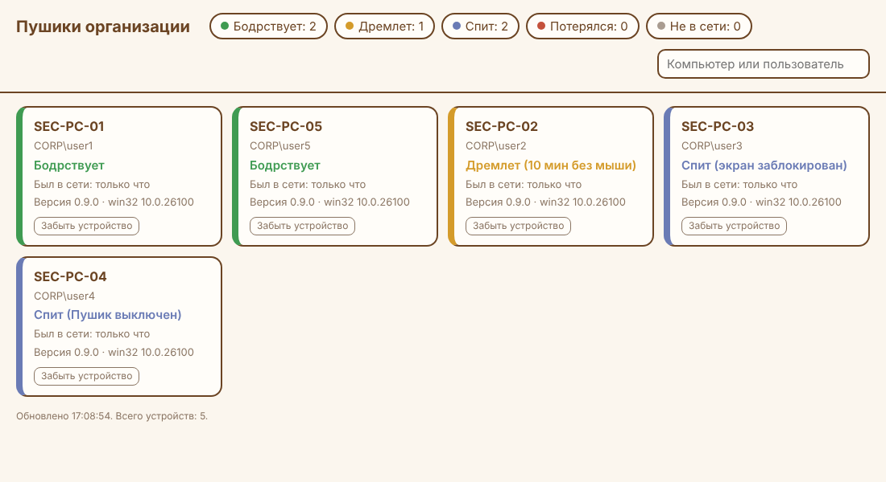

# Сервер присутствия Пушика

Маленький сервер для пилота: Пушики организации сообщают, бодрствуют они, дремлют или спят,
а администратор видит их на одной странице.



## Запуск

```sh
cd server
npm install            # нужен только для PostgreSQL (пакет pg)
ENROLL_SECRET='длинный-секрет-регистрации' \
ADMIN_PASSWORD='пароль-администратора' \
DATABASE_URL='postgres://pushik:…@db/pushik' \
TLS_CERT=/etc/pushik/cert.pem TLS_KEY=/etc/pushik/key.pem \
node index.mjs
```

| Переменная | Что значит |
|---|---|
| `ENROLL_SECRET` | Тот же секрет, что `presence.secret` в политике. От 16 знаков |
| `ADMIN_PASSWORD` | Пароль страницы, пользователь `admin`. От 12 знаков. Вход через Keycloak/AD — задача E-35 |
| `DATABASE_URL` | PostgreSQL. Без него устройства хранятся в памяти до перезапуска (для проверки) |
| `PORT` | 8443 по умолчанию |
| `TLS_CERT`, `TLS_KEY` | Сертификат и ключ. Без них сервер отвечает по http — тогда ставьте его за nginx с TLS |

Таблицы в PostgreSQL создаются сами. Нужен Node.js 20 или новее.

## Как это работает

- `POST /api/enroll` — Пушик присылает секрет и ключ устройства (хеш GUID машины и SID пользователя),
  получает свой токен. В базе хранится только хеш токена. Не больше 20 регистраций в минуту с адреса.
- `POST /api/beat` — раз в 45 секунд и сразу при блокировке, сне, выходе. Только состояние и версия.
- Три пропуска подряд (135 с) — кот «потерялся», час тишины — «не в сети». Кот, который сказал
  «сплю», остаётся спящим до 7 дней.
- `GET /` — страница со списком (пароль администратора), обновляется раз в 15 секунд.
- «Забыть устройство» удаляет его; токен перестаёт работать, и Пушик регистрируется заново.

Тесты сервера лежат в `test/presence.test.ts` основного проекта.
